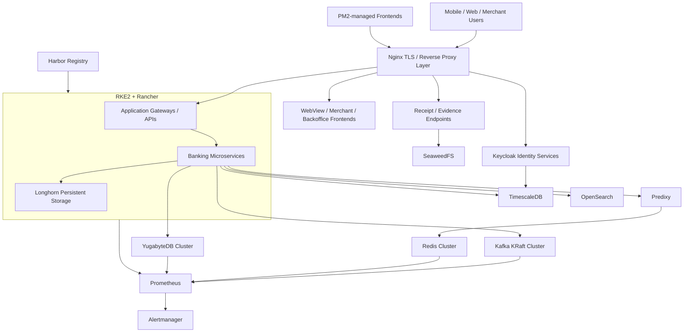

# Banking Digital Platform Infrastructure — Sanitized Case Study

This case study documents a sanitized version of hands-on infrastructure work performed across **UAT and production banking environments**. It focuses on the platform components, operational responsibilities, integration patterns, and hardening work involved in running a multi-service digital banking platform.

> Customer names, internal IPs, credentials, certificates, domains, cluster identifiers, and environment-specific secrets are intentionally excluded. The architecture below is generalized from real work rather than copied from a customer environment.

## Scope of work

The environment included a mix of Kubernetes-hosted and VM-hosted services spanning application delivery, identity, messaging, caching, storage, databases, observability, artifact management, and edge routing.

Core technologies included:

- **RKE2 + Rancher UI** for Kubernetes platform operations
- **Longhorn** for Kubernetes persistent storage
- **Harbor** for private container image management
- **Kafka/KRaft** as a multi-node messaging cluster
- **Redis Cluster + Predixy** for distributed caching and cluster-aware application access
- **YugabyteDB** as a distributed SQL cluster
- **TimescaleDB** for standalone PostgreSQL/Timescale workloads and supporting application data
- **Keycloak** for identity and access management, including separate identity domains for different products
- **Nginx** for TLS termination, reverse proxying, routing, and secure domain exposure
- **SeaweedFS** for receipt/image/object-style storage workflows
- **PM2** for selected frontend/backoffice Node.js process management
- **OpenSearch** for centralized logging and observability workflows
- **Prometheus + Alertmanager** for metrics and alerting
- **OpenTelemetry** for application telemetry integration where applicable

## High-level architecture

The exact placement of individual applications and supporting services varied between UAT and production. The diagram intentionally shows the functional relationships rather than a customer-specific topology.

## Platform responsibilities demonstrated

### Kubernetes and application platform

- installed and operated RKE2 environments through Rancher
- worked with control-plane and worker-node separation
- managed deployments, Services, ConfigMaps, Secrets, image pulls, storage, and workload troubleshooting
- operated Longhorn-backed persistent workloads
- validated application behavior after infrastructure changes instead of relying only on pod readiness

### Messaging and caching

- operated Kafka in KRaft mode across multiple nodes
- introduced a parallel mTLS application listener and migrated Java/Spring/WildFly clients without taking down the whole cluster
- validated quorum health, TLS handshakes, application runtime properties, consumer-group joins, partition assignment, and multi-broker communication
- operated Redis Cluster with master/replica topology
- used Predixy as the application-facing proxy layer for cluster-aware routing and authentication handling

### Identity and edge services

- operated Keycloak-backed identity services for more than one product boundary
- integrated Keycloak with database services
- configured Nginx as the secure ingress/reverse-proxy layer for multiple application domains and routes
- handled TLS, routing, application gateways, receipt/evidence endpoints, web views, merchant portals, and identity endpoints

### Data and storage

- operated YugabyteDB as a distributed SQL cluster
- supported standalone TimescaleDB/PostgreSQL workloads
- used SeaweedFS for receipt/image storage flows
- supported persistent storage through Longhorn for Kubernetes workloads

### Artifact delivery and process management

- operated Harbor as the internal container registry
- managed application image pull configuration and registry secrets
- supported PM2-managed frontend/backoffice processes outside Kubernetes where appropriate

### Observability and incident response

- deployed and operated Prometheus/Alertmanager monitoring
- implemented OpenSearch-based log and observability workflows
- separated application logs from platform/Kubernetes logs for cleaner operations
- validated alerts, retention, disk usage, and telemetry paths
- used logs, metrics, service health, runtime configuration, and direct protocol tests together during incident investigation

## Security hardening examples

The environment evolved from basic connectivity toward stronger controls, including:

- Kafka application traffic migrated from legacy PLAINTEXT listeners to **TLS with mandatory client certificates**
- separate application certificate identities rather than one shared client certificate
- broker certificate SAN validation and hostname/IP verification
- Kubernetes Secret handling for PKCS12/JKS certificate stores
- Redis authentication validated through the application and Predixy path
- TLS termination and controlled domain exposure through Nginx
- public portfolio documentation sanitized to exclude production secrets and customer identifiers

## UAT to production workflow

A typical infrastructure change followed this pattern:

1. inspect the current runtime configuration and dependencies
2. back up configuration before edits
3. validate the change in UAT
4. test both infrastructure health and application behavior
5. prepare rollback steps
6. roll changes gradually in production where possible
7. validate service health, quorum/replication state, logs, client connectivity, and business flow
8. keep the previous path temporarily when a staged migration reduced risk
9. retire legacy configuration only after all consumers were confirmed migrated

## Evidence boundaries

This is a **sanitized production case study**, not a downloadable copy of a bank environment.

It demonstrates the scope of real platform work while intentionally excluding:

- customer or bank names
- real IP addresses and DNS names
- passwords, tokens, private keys, certificates, and keystores
- production database contents
- proprietary application source code
- exact customer sizing or capacity values
- claims about uptime, transaction volume, or performance that were not independently measured

Supporting technical details are captured in the adjacent Kafka, Redis, RKE2, Linux, database, networking, Java, and observability runbooks in this repository.
