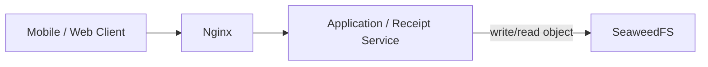
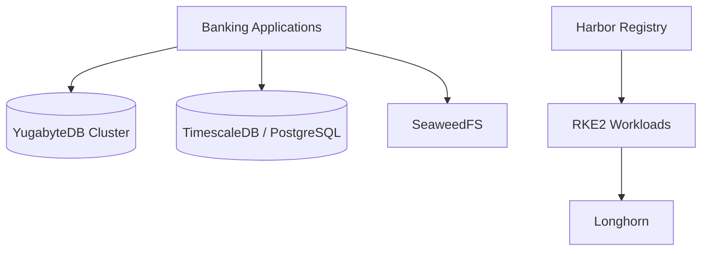

# Databases and Storage

This document summarizes the sanitized data and storage layer used by the banking platform.

## YugabyteDB

YugabyteDB was operated as a distributed SQL cluster for application workloads that required horizontally distributed database services.

Operational responsibilities included:

- cluster/service health checks
- application connectivity validation
- YSQL troubleshooting
- schema/migration verification
- distinguishing database readiness from application migration problems
- validating that services could reconnect after infrastructure changes

## TimescaleDB / PostgreSQL

Standalone TimescaleDB/PostgreSQL services supported selected platform workloads, including identity-related database requirements and other application data.

Typical checks included:

- service state and listener availability
- database connectivity from the consuming application
- credentials and environment configuration
- schema/Flyway history validation
- storage capacity and filesystem health

## SeaweedFS

SeaweedFS supported receipt/image/object-style storage workflows.

A simplified functional relationship is:

The public case study intentionally avoids reproducing storage paths, volume layouts, customer bucket/collection names, or receipt identifiers.

## Longhorn

Longhorn provided persistent storage for Kubernetes workloads running on RKE2.

Operational work included:

- PVC and volume troubleshooting
- replica/volume health awareness
- handling stale webhook or deletion-related problems
- validating that application state remained available after workload rescheduling
- separating Kubernetes object state from the actual storage-layer condition

## Harbor

Harbor provided the internal container image registry used by Kubernetes workloads.

Operational tasks included:

- image push/pull validation
- registry-secret troubleshooting
- image tag verification
- connectivity and storage-backend troubleshooting
- validating that Kubernetes was using the intended image rather than relying only on deployment metadata

## Data-path view

## Operational principle

Database or storage health was not inferred from process state alone. Verification required checking the consuming application, storage availability, schema state, and actual read/write behavior where safe to do so.
