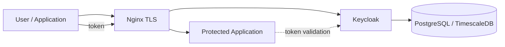

# Identity and Keycloak

This document summarizes the sanitized identity layer used by the banking platform.

## Role of Keycloak

Keycloak provided identity and access management for application users and services. The environment included more than one identity boundary, including a separate Keycloak instance or route for another product area rather than forcing every product into one identity context.

Keycloak used a relational database backend, including TimescaleDB/PostgreSQL-backed application data in the wider platform.

## Simplified identity flow

## Operational responsibilities

Work around the identity layer included:

- configuring and operating Keycloak services
- validating database connectivity
- maintaining secure reverse-proxy exposure through Nginx
- separating identity endpoints for different product boundaries where required
- checking service startup, logs, ports, and runtime configuration
- troubleshooting application authentication problems by distinguishing Keycloak health from application-side configuration

## Troubleshooting approach

Authentication failures were investigated layer by layer:

1. Keycloak process/service health
2. database connectivity
3. Nginx/TLS route
4. realm/client configuration
5. application endpoint/configuration
6. token issuance and validation behavior

A successful Keycloak login page alone does not prove that an application has the correct realm, client, redirect URI, secret, or endpoint configuration.

## Security boundaries

The public case study intentionally excludes:

- realm names
- client IDs tied to customer systems
- client secrets
- administrative credentials
- real URLs and certificates
- user/account information

The purpose of this document is to show the operational architecture and troubleshooting method without publishing identity configuration from a banking environment.
