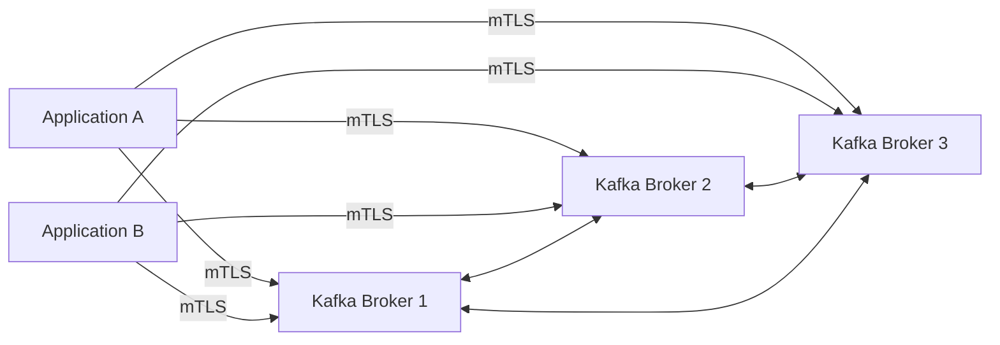
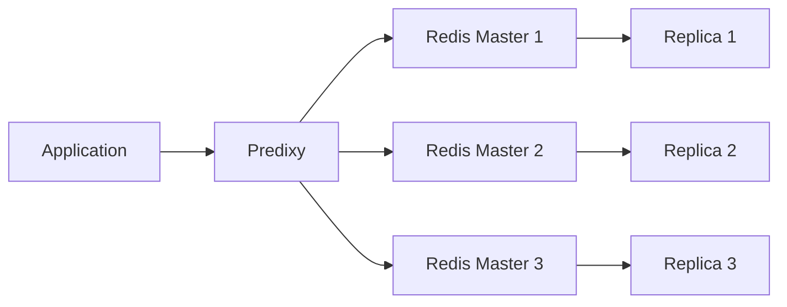

# Messaging and Cache Layer

This document summarizes the sanitized Kafka and Redis architecture used by the banking platform.

## Kafka / KRaft

Kafka ran as a multi-node KRaft cluster. Application clients used Kafka for asynchronous messaging and event-driven integration between services.

The production hardening work included migrating application traffic from legacy PLAINTEXT listeners to a parallel mTLS listener with mandatory client certificates.

Validation included:

- KRaft quorum state
- listener health
- broker certificates and SANs
- client certificates
- PKCS12/JKS store integrity
- application runtime properties
- producer/consumer connectivity
- consumer-group joins and assignments
- partition-leader communication across brokers

## Redis Cluster + Predixy

Redis used a clustered master/replica topology. Predixy provided a stable application-facing endpoint and cluster-aware routing layer.

Operational work included:

- validating Redis Cluster state and slot ownership
- handling `MOVED` behavior correctly
- checking proxy routing through Predixy
- validating Redis authentication in the application path
- distinguishing Redis-node health from proxy or application configuration issues

## Design distinction

Kafka bootstrap addresses are discovery seeds. After metadata retrieval, Kafka clients communicate with the broker responsible for the required partition.

Predixy is different: it remains in the Redis request path and routes application operations to the correct Redis node.

## Safety boundaries

No production broker addresses, Redis passwords, client certificates, keystores, cluster IDs, or application-specific secrets are included in this public case study.
