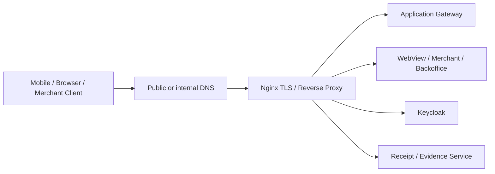

# Networking, Nginx, TLS, and Application Exposure

This document summarizes the sanitized edge and routing responsibilities involved in exposing banking application services securely.

## Role of Nginx

Nginx acted as a controlled application-facing reverse-proxy and TLS termination layer for several service categories, including:

- mobile application gateway/API routes
- receipt and transaction-evidence endpoints
- webview content
- merchant-facing portals
- backoffice/front-end services
- identity endpoints
- separate identity routes for another product boundary

The exact customer domains and addresses are intentionally excluded.

## Simplified flow



## Operational responsibilities

Typical work included:

- defining `server_name` and TLS-enabled virtual hosts
- routing separate domains or paths to the correct upstream services
- validating upstream ports and application health
- checking certificate validity and trust
- testing HTTP/HTTPS behavior with `curl` and OpenSSL tools
- differentiating a network/TLS problem from an application problem
- reloading Nginx safely after configuration validation
- keeping internal application addresses out of client-facing configuration

## Safe change sequence

```bash
nginx -t
```

Only after configuration validation should the service be reloaded:

```bash
systemctl reload nginx
```

Then validate the complete path:

```text
DNS -> TLS handshake -> Nginx virtual host -> upstream -> application response
```

A listening Nginx process alone does not prove that the correct domain reaches the correct application.

## Troubleshooting model

When a route failed, the investigation was separated into layers:

1. DNS resolution
2. TCP reachability
3. TLS certificate/handshake
4. Nginx virtual-host matching
5. proxy/upstream address and port
6. upstream service health
7. application-specific response

This prevented application failures from being misdiagnosed as proxy failures and vice versa.

## Security considerations

- TLS certificates and private keys are never committed to Git
- internal IPs and real hostnames are omitted from this case study
- each public route should expose only the minimum required application surface
- backend administration ports should remain network-restricted
- redirects, headers, timeouts, upload limits, and proxy behavior should be reviewed per application rather than copied blindly
