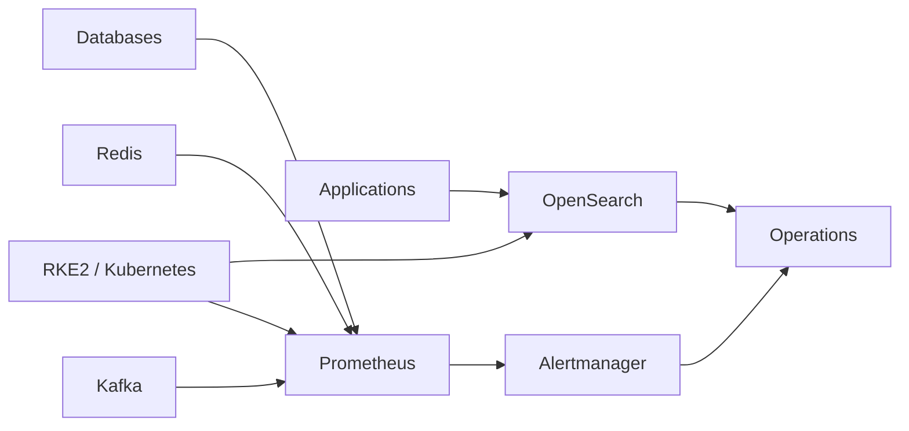

# Observability and Alerting

This document summarizes the sanitized observability layer used around the banking platform.

## Core components

- **Prometheus** for metrics collection
- **Alertmanager** for alert routing and notification handling
- **OpenSearch** for centralized logs and operational investigation
- **OpenTelemetry** where application telemetry integration was available

## Observability flow



## Operational work demonstrated

- separating application logs from platform/Kubernetes logs for cleaner investigation
- validating the actual event timestamp used in OpenSearch data
- checking Prometheus retention against the history window required by operations
- validating alert rules before enabling notification routes
- standardizing Alertmanager notifications so firing and resolved states were understandable
- monitoring filesystem usage and other node-level conditions
- using metrics and logs together instead of treating one data source as sufficient proof

## Application vs platform views

A useful operating distinction was:

```text
Application view
  - application errors
  - request/latency behavior
  - service dependencies
  - business-service logs

Platform view
  - RKE2/Kubernetes
  - node resources
  - storage
  - cluster/system services
  - infrastructure logs
```

Keeping these views separate reduces noise and helps different audiences focus on the layer they own.

## Alert validation principle

An alert was not considered complete just because Prometheus loaded the rule file. Validation included:

1. configuration/rule syntax
2. matching time series
3. expected firing condition
4. Alertmanager receipt
5. notification formatting/routing
6. resolved-state behavior

## Evidence boundaries

Real alert destinations, internal hosts, customer names, service names, IP addresses, and operational thresholds tied to a specific bank are intentionally excluded from the public case study.
